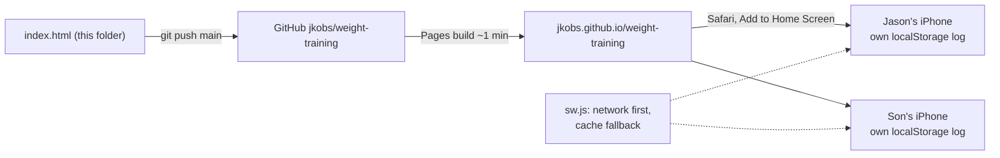

# Weight Training (weight-training)

Started as "Bench 225" (renamed 2026-11-09). The goal is still a 225 lb bench, and the icon still shows 225.

A private bench press program app for Jason and his son, one iPhone each. It's a static web app that you add to the Home Screen. There's no backend, and each phone keeps its own log in `localStorage`.

- Live: https://jkobs.github.io/weight-training/
- Repo: `jkobs/weight-training` (public, branch `main`). GitHub Pages serves the repo root, and every push to `main` redeploys in about a minute.

## How it fits together

## Files

| File | What it is |
|---|---|
| `index.html` | The whole app: program table, logic, UI. No build step. |
| `manifest.json`, `icon-*.png`, `icon.svg` | Home Screen install and icon. `tools/tests/core.mjs` re-renders the PNGs from `icon.svg`. |
| `sw.js` | Service worker. Network first so updates show at once, with a cache fallback for the gym. |
| `tools/build-artifact.sh` | Builds `artifact.html` (gitignored), a Claude-artifact copy without alert/confirm or a service worker. Only needed to publish a private Claude link again. |
| `tools/tests/*.mjs` | Playwright tests (headless Chromium at 390 px). They borrow Playwright from `../solunar-fishing-app/node_modules`. |
| `TASKS.md` | Task board. |

## Program model

- Weights are fractions of the lifter's current estimated 1RM (Epley, `w × (1 + r/30)`), rounded to 5 lb with a 45 lb bar. The table is `PROGRAM` in `index.html`: Heavy, Volume and Paused days; week 3 adds a max-reps set; week 4 is a deload plus a max test.
- A program is 4, 8, 12 or 16 weeks, made of back-to-back 4-week blocks. Each block's max test sets `state.max` for the next block.
- The outlook uses about **10 lb per block** (`GAIN_PER_BLOCK`). That's a planning estimate, not measured.
- State lives under `localStorage` key `bench225-v1`. Never rename it: phones would lose their logs. `load()` migrates older saves (adds `goal` 225 and `weeks` 4).

## Rules

- Don't use `alert`, `confirm` or `prompt`. Use `toast()` and the two-tap `confirmTap()`, which also work inside a Claude artifact.
- Run both test suites before pushing:
  `node tools/tests/core.mjs "$PWD" <shots-dir>` and `node tools/tests/goal-length.mjs "$PWD" <shots-dir>`. After deploying, run `node tools/tests/live-check.mjs`.
- Ask Jason before pushing. A push goes live on both phones right away.
- Workout logs never leave the phones. Don't add analytics or any network calls with user data.
